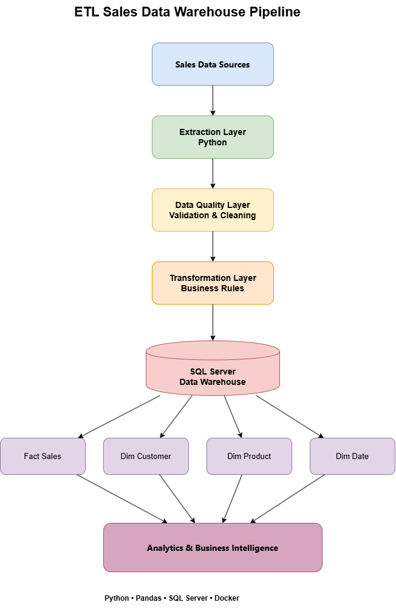

# ETL Sales Data Warehouse Pipeline


Proyecto de ingeniería de datos que implementa un pipeline ETL (Extract, Transform, Load) utilizando Python, Docker y SQL Server.

El sistema procesa datos comerciales, aplica reglas de limpieza y calidad, y carga la información en un entorno preparado para análisis y generación de indicadores. La solución se ejecuta íntegramente en contenedores Docker, permitiendo un despliegue reproducible y simplificando la configuración del entorno.

---

## Arquitectura


---

## Objetivo

Este proyecto simula un escenario de análisis comercial donde los datos de ventas requieren limpieza, transformación e integración antes de ser utilizados para reporting y análisis de negocio.

El objetivo es demostrar cómo automatizar un flujo de procesamiento de datos utilizando herramientas ampliamente utilizadas en proyectos de ingeniería de datos.


## Technology Stack

- Python & Pandas
- SQL Server
- Docker & Docker Compose
- Git & GitHub


## Funcionalidades

- Extracción de datos comerciales.
- Limpieza y validación de información.
- Transformación de datos para análisis.
- Carga automatizada en SQL Server.
- Ejecución mediante contenedores Docker.
- Base preparada para Data Warehousing y Business Intelligence.

---

## Resultados

Este proyecto demuestra la implementación práctica de:

- Procesos ETL.
- Ingeniería de Datos.
- Automatización con Python.
- Limpieza y calidad de datos.
- SQL Server.
- Docker y Docker Compose.
- Diseño de soluciones orientadas al análisis de información.

---

## Instalación

### Clonar el repositorio

```bash
git clone https://github.com/JES-data/etl-sales-dw-pipeline.git
```

### Acceder al proyecto

```bash
cd etl-sales-dw-pipeline
```

### Levantar el entorno

```bash
docker compose up --build
```

### Verificar contenedores

```bash
docker ps
```

---

## Casos de Uso

La arquitectura implementada puede adaptarse a escenarios como:

- Automatización de cargas de datos.
- Consolidación de información comercial.
- Procesamiento de ventas.
- Integración de fuentes de datos.
- Alimentación de Data Warehouses.
- Preparación de datos para Power BI.
- Soluciones de Business Intelligence para PyMEs.

---

## Sobre JES Data

**JES Data** desarrolla soluciones de ingeniería de datos, automatización de procesos ETL, análisis de datos y Business Intelligence para ayudar a organizaciones a transformar datos en información útil para la toma de decisiones.

---

## Autor

### Juan Eduardo Shifres

Founder @ JES Data

- LinkedIn: https://www.linkedin.com/in/juan-shifres/
- GitHub: https://github.com/JES-data
- Sitio Web: https://jesdata.com.ar

---

## Licencia

Proyecto publicado con fines educativos, demostrativos y de portfolio profesional.